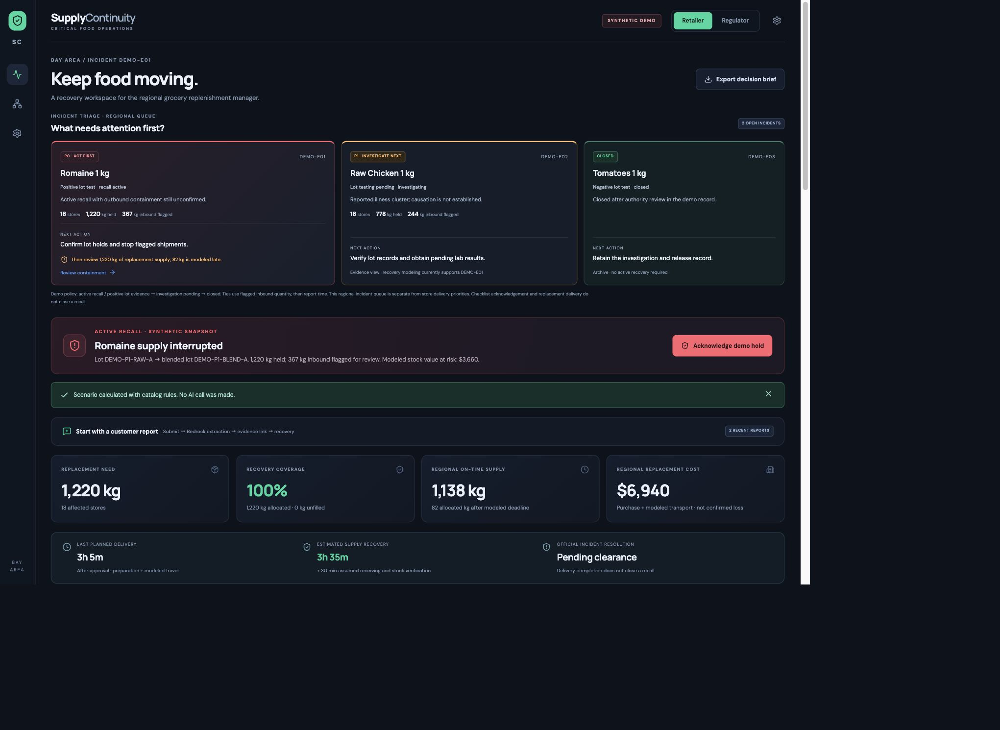

# Hi, I'm hyuntori2000.

I build web and mobile software with TypeScript, Dart, and JavaScript. My recent work explores how software can help people respond to food supply disruptions.

**[Explore my portfolio ↗](https://hyuntori2000.github.io/hyuntori2000/)**

## Featured project

### [FoodTraceAI · Supply Continuity](https://github.com/hyuntori2000/supply-continuity)

**What happens when two suppliers depend on the same closed warehouse?** In the demo’s Oakland closure scenario, one independent supplier can cover **611 of 1,591 kg** of romaine demand. The dashboard shows the remaining shortage before a manager approves the plan.

Amazon Bedrock interprets the report and operator requests. TypeScript enforces inventory and allocation rules. The AWS deployment connects Amplify, API Gateway, Lambda, and DynamoDB. All supply and demand figures are modeled.

[Walk through the incident workflow](https://github.com/hyuntori2000/supply-continuity/blob/HEAD/docs/NEW_INCIDENT_WORKSPACE.md) · [Explore the AWS backend](https://github.com/hyuntori2000/supply-continuity/tree/HEAD/aws)

## More work

| Project | What I explored |
| --- | --- |
| [TikTok Clone](https://github.com/hyuntori2000/TikTok-Clone-Code) | Mobile onboarding, authentication, and discovery with Flutter and Dart |
| [Vanilla JS Dashboard](https://github.com/hyuntori2000/vanilajschallenge) | A browser start page with a clock, to-dos, weather, and quotes |
